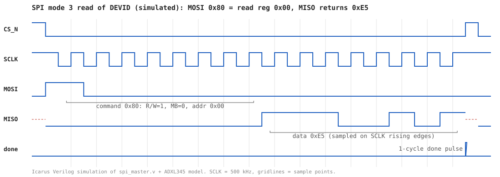

# FPGA SPI Protocol: ADXL345 Tilt Display

[](https://github.com/Aeeonn/FPGA-SPI-Protocol/actions/workflows/simulation.yml)

A from-scratch Verilog **SPI master** and **ADXL345 accelerometer controller** running on a Terasic **DE10-Lite** (Intel MAX 10) board. The board's tilt along the X axis is shown as a smoothly fading "bubble level" on the 10 red LEDs.

**Highlights**
- SPI mode 3 master written from scratch: no vendor IP, no soft CPU
- Interrupt-driven sensor reads using the ADXL345 DATA_READY interrupt, with a synchronizer for the asynchronous INT2 pin
- PWM LED driver with per-LED brightness fading
- Debugged on hardware with Signal Tap; verified in simulation with self-checking testbenches and a behavioral ADXL345 model, run automatically by GitHub Actions on every push



*An SPI read of the DEVID register, generated from the testbench: the master sends `0x80` (read, address `0x00`) and the sensor model answers `0xE5`.*

## Architecture

```
 MAX10_CLK1_50 ──► adxl345_controller ──► led_driver ──► LEDR[9:0]
                     │            ▲
                     ▼            │ INT2 (DATA_READY)
                  spi_master ◄────┘
                     │
        SCLK / CS_N / SDI / SDO
                     ▼
                  ADXL345
```

| Path | Description |
|------|-------------|
| [`USE_ACCEL.v`](USE_ACCEL.v) | Top-level module: connects board pins to the controller |
| [`spi_master.v`](spi_master.v) | 16-bit SPI master, mode 3 (CPOL=1, CPHA=1), 500 kHz SCLK from the 50 MHz clock |
| [`adxl345_controller.v`](adxl345_controller.v) | State machine that configures the ADXL345 and reads X-axis data on each data-ready interrupt |
| [`led_driver.v`](led_driver.v) | Maps the signed X reading to LED positions with PWM brightness and smooth fading |
| [`btn_pulse.v`](btn_pulse.v) | Push-button synchronizer / rising-edge pulse helper (not used in the current top level) |
| [`USE_ACCEL.sdc`](USE_ACCEL.sdc) | Timing constraints (50 MHz / 10 MHz clocks) |
| [`USE_ACCEL.qpf`](USE_ACCEL.qpf), [`USE_ACCEL.qsf`](USE_ACCEL.qsf) | Quartus project and pin assignments |
| [`stp2.stp`](stp2.stp) | Signal Tap logic analyzer setup used to debug the SPI bus on hardware |
| [`sim/`](sim) | Testbenches, ADXL345 SPI model, and test runners |
| [`.github/workflows/simulation.yml`](.github/workflows/simulation.yml) | CI: runs every testbench on each push |

## How it works

### SPI master ([`spi_master.v`](spi_master.v))
- Divides the 50 MHz system clock to a 1 MHz enable tick; SCLK toggles on each tick, so SCLK runs at 500 kHz (well under the ADXL345's 5 MHz limit).
- Idles with `CS_N` high and `SCLK` high (SPI mode 3, as required by the ADXL345).
- Shifts a 16-bit word out MSB-first (8-bit command/address + 8-bit data), shifts MOSI on the falling edge, and samples MISO on the rising edge.
- Raises `done` for exactly one 50 MHz cycle when the transfer completes, with the received byte on `rx_data`.

### ADXL345 controller ([`adxl345_controller.v`](adxl345_controller.v))
1. Waits about 20 ms after reset for the sensor to power up.
2. Writes `0x2E = 0x80` (INT_ENABLE: DATA_READY).
3. Writes `0x2F = 0x80` (INT_MAP: DATA_READY → INT2).
4. Writes `0x2D = 0x08` (POWER_CTL: measurement mode).
5. Waits for INT2 (passed through a 3-flop synchronizer), then reads `DATAX0` (`0xB2`) and `DATAX1` (`0xB3`). Reading the data registers clears the interrupt.
6. Waits for INT2 to fall again, then repeats. At the default 100 Hz output data rate this happens every 10 ms.

Each SPI transaction uses a handshake: the controller asserts `start`, then waits in a dedicated state until the master's `done` pulse before issuing the next command.

### LED driver ([`led_driver.v`](led_driver.v))
- Takes the 10-bit two's-complement X value, computes its absolute value, and uses the top bits as a tilt magnitude.
- Lights a bright center LED with dimmer neighbors that move left or right according to the tilt direction.
- Each LED has an 8-bit brightness target. The displayed brightness steps toward the target once per millisecond to create the fade, and a shared 8-bit PWM counter drives the LEDs.

## Design notes

- **Clock-enable instead of a derived clock.** SCLK is generated as a register in the 50 MHz domain, driven by a 1 MHz enable pulse. The whole design therefore runs on one clock with no gated or ripple clocks, so static timing analysis covers every path.
- **Mode 3 timing.** MOSI changes on SCLK falling edges and MISO is sampled on rising edges, so data has half an SCLK period (1 µs) to settle in each direction.
- **Interrupt-driven, not polled.** The controller only touches the bus when the sensor reports new data, so it never reads the same sample twice or misses one. The testbench checks both.
- **Asynchronous input handling.** INT2 comes from off-chip, so it passes through a shift-register synchronizer before the state machine uses it.
- **Explicit start/done handshake.** One 16-bit transfer takes about 1,700 system clock cycles, so the controller waits in a dedicated state for `done` before loading the next command.

## Verification

All testbenches are self-checking. Each one prints `TEST PASSED` or fails with a non-zero exit code, and [GitHub Actions](.github/workflows/simulation.yml) runs them all with Icarus Verilog on every push.

| Testbench | What it checks |
|-----------|----------------|
| [`tb_spi_master.v`](sim/tb_spi_master.v) | DEVID read returns `0xE5`; write/read-back of bit patterns (`00 FF A5 5A 01 80`); SCLK exactly 500 kHz and idle-high; single-cycle `done`; recovery from a reset in the middle of a transfer |
| [`tb_led_driver.v`](sim/tb_led_driver.v) | Tilt-to-LED mapping for every magnitude band in both directions; 1 ms fade steps; PWM duty cycle equals brightness; fade settles at target |
| [`tb_use_accel.v`](sim/tb_use_accel.v) | Full system with the sensor model: reset indicator, ~20 ms power-up delay, configuration write sequence, interrupt-driven reads with no missed or stale samples, X readings reaching the LEDs, re-initialization after a second reset |

[`adxl345_model.v`](sim/adxl345_model.v) is a behavioral model of the sensor's SPI interface and register file. It also acts as a protocol checker: it flags CPOL violations, SCLK faster than 5 MHz, transfers that aren't 16 bits, and reads without a DATA_READY interrupt. In the system test its output data rate is sped up to 5 kHz to keep simulation short.

**Run locally** (requires [Icarus Verilog](https://steveicarus.github.io/iverilog/)):

```bash
make -C sim          # all testbenches
make -C sim wave     # dump a VCD and regenerate docs/spi_read_waveform.svg
```

On Windows, run `sim\run_tests.ps1` (add `-Wave` to regenerate the waveform).

## Results

From Quartus Prime Lite 23.1, compiled for the `10M50DAF484C7G`. The figures include the Signal Tap debug instance.

| Metric | Value |
|--------|-------|
| Logic elements | 1,124 / 49,760 (2%) |
| Registers | 649 |
| Pins | 79 / 360 |
| Timing (50 MHz, slow 85 °C model) | Met, +10.0 ns setup slack |

## Hardware

- **Board:** Terasic DE10-Lite
- **FPGA:** Intel MAX 10 `10M50DAF484C7G`
- **Sensor:** Analog Devices ADXL345 (onboard, 4-wire SPI)
- **Reset:** `KEY[0]` (active low). `HEX0` shows a reset indicator while reset is held.

## Building

1. Open `USE_ACCEL.qpf` in **Quartus Prime Lite 23.1** (any recent Lite version that supports MAX 10 should work).
2. Run **Processing → Start Compilation**.
3. Program the board with **Tools → Programmer** using `USE_ACCEL.sof`.
4. Tilt the board left and right to see the LEDs follow.

## Possible extensions

- Read all three axes with a single multi-byte burst (`0xF2`, MB=1), which avoids mixing bytes from two different samples
- Show the raw reading in hex on the seven-segment displays
- Handle the full-scale reading of -512 (-2 g): the 9-bit absolute value overflows, so that one value is displayed as flat

## Author

Justin Dubreuil
